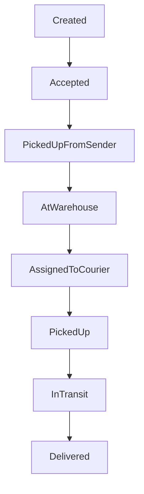

# CargoTracking

### Cargo Management and Tracking API

A backend cargo management and tracking system built with **ASP.NET Core 9**, following **Clean Architecture** and **CQRS** principles.

CargoTracking provides shipment management, automatic courier assignment, warehouse operations, shipment tracking, and reliable asynchronous background processing.

<p align="center">

  **.NET 9 · Clean Architecture · CQRS · SQL Server · Redis · RabbitMQ · Docker**

</p>

---

## Table of Contents

- [Overview](#overview)
- [Key Features](#key-features)
- [Technologies](#technologies)
- [Architecture](#architecture)
- [Shipment Lifecycle](#shipment-lifecycle)
- [Background Processing](#background-processing)
- [Concurrency Management](#concurrency-management)
- [Testing](#testing)
- [Docker and Deployment](#docker-and-deployment)
- [CI/CD Pipeline](#cicd-pipeline)
- [Getting Started](#getting-started)
- [API Documentation](#api-documentation)

---

## Overview

CargoTracking is designed to demonstrate real-world backend development practices using the .NET ecosystem.

The application supports different user roles and manages the complete shipment lifecycle, from shipment creation to final delivery.

It also uses Redis for geographical proximity operations, RabbitMQ for asynchronous messaging, and the Outbox Pattern for reliable background message processing.

## Key Features

| Feature | Description |
|---|---|
| Authentication | JWT authentication and Refresh Token management |
| Authorization | Role-based access control |
| Shipment Management | Shipment creation, status updates, delivery, and returns |
| Courier Management | Courier profiles, availability, and location updates |
| Automatic Courier Assignment | Assigns nearby available couriers using Redis Geospatial |
| Warehouse Management | Warehouse selection, receiving, and shipment transfers |
| Shipment Tracking | Historical shipment status and tracking events |
| Background Processing | Outbox Pattern and RabbitMQ messaging |
| Email Notifications | Asynchronous email notifications through SMTP |
| Health Monitoring | SQL Server and Redis health checks |

## Technologies

### Backend

| Technology | Version |
|---|---:|
| C# | - |
| .NET | 9 |
| ASP.NET Core Web API | 9 |
| Entity Framework Core | 9.0.20 |
| SQL Server | - |
| MediatR | 14.2.0 |
| FluentValidation | 12.2.0 |
| Swagger / OpenAPI | - |

### Authentication and Security

- JWT Bearer Authentication
- Refresh Token mechanism
- Role-based Authorization
- Password Hashing with ASP.NET Core Identity's PasswordHasher
- Centralized Exception Handling

### Distributed Systems and Infrastructure

| Technology | Version | Purpose |
|---|---:|---|
| Redis | - | Geospatial operations |
| StackExchange.Redis | 3.4.5 | Redis integration |
| RabbitMQ | 4 | Message broker |
| RabbitMQ.Client | 7.2.2 | RabbitMQ integration |
| MailKit | 4.18.2 | SMTP email delivery |
| Docker | - | Containerization |
| Docker Compose | - | Container configuration |
| GitHub Container Registry | - | Docker image storage |

### Database and Health Monitoring

| Package | Version | Purpose |
|---|---:|---|
| Microsoft.EntityFrameworkCore.SqlServer | 9.0.20 | SQL Server provider |
| EF Core Migrations | 9.0.20 | Database schema management |
| AspNetCore.HealthChecks.Redis | 9.0.0 | Redis health checks |
| EF Core Health Checks | 9.0.23 | Database health checks |

### Testing and CI/CD

| Technology | Version | Purpose |
|---|---:|---|
| xUnit | 2.9.2 | Automated testing |
| Moq | 4.21.0 | Mocking dependencies |
| EF Core InMemory | 9.0.20 | In-memory database testing |
| Microsoft.NET.Test.Sdk | 17.12.0 | Test execution |
| Coverlet Collector | 6.0.2 | Code coverage collection |
| GitHub Actions | - | CI/CD automation |

### Architecture and Design Patterns

- Clean Architecture
- CQRS
- Dependency Injection
- Outbox Pattern
- Background Services
- Optimistic Concurrency Control
- Manual Mapping

## Architecture

CargoTracking follows Clean Architecture principles to separate business logic, application use cases, infrastructure concerns, and HTTP communication.

The solution consists of five projects:

```text
CargoTracking/
│
├── CargoTracking.API/
│   ├── Configuration/
│   ├── Contracts/
│   ├── Controllers/
│   ├── Exceptions/
│   ├── Initialization/
│   ├── Services/
│   ├── Swagger/
│   ├── Dockerfile
│   └── Program.cs
│
├── CargoTracking.Application/
│   ├── Abstractions/
│   ├── Behaviors/
│   ├── Events/
│   ├── Exceptions/
│   ├── Features/
│   └── Interfaces/
│
├── CargoTracking.Domain/
│   ├── Common/
│   ├── Entities/
│   └── Enums/
│
├── CargoTracking.Infrastructure/
│   ├── BackgroundJobs/
│   ├── Messaging/
│   ├── Migrations/
│   ├── Options/
│   ├── Persistence/
│   ├── Redis/
│   ├── Services/
│   └── Settings/
│
└── CargoTracking.Tests/
```

### Layer Responsibilities

**Domain Layer**

Contains core business entities, base entity definitions, enumerations, and business rules. It is independent of infrastructure technologies.

**Application Layer**

Contains application use cases organized around CQRS.

- Commands handle operations that change application state.
- Queries retrieve application data.
- MediatR dispatches requests to their handlers.
- FluentValidation validates commands.
- Abstractions define contracts for infrastructure services.

**Infrastructure Layer**

Implements external dependencies and technical concerns.

- Entity Framework Core and SQL Server persistence
- Database configurations and migrations
- Redis geospatial operations
- RabbitMQ message publishing and consumers
- Outbox background processing
- JWT and Refresh Token services
- SMTP email delivery

**API Layer**

Provides the HTTP interface to the application.

- Controllers and request contracts
- JWT authentication and authorization
- Current user service
- Global exception handling
- Swagger configuration
- Dependency Injection and service registration
- Admin initialization

**Tests Layer**

Contains automated tests for application behavior, database operations, concurrency, and infrastructure-related scenarios.

## Shipment Lifecycle

A shipment moves through different statuses during its lifecycle.



Additional flows support:

- Delivery failures
- Shipment returns
- Warehouse transfers
- Shipment cancellations

These transitions are controlled by domain business rules.

## Background Processing

CargoTracking uses the **Outbox Pattern** to improve the reliability of asynchronous message publishing.

The background processing flow:

1. Application operations create Outbox messages.
2. A background service periodically checks pending messages.
3. Messages are claimed for processing.
4. The publisher sends messages to RabbitMQ.
5. Consumers process the messages.
6. Failed messages are retried using exponential backoff.

The system also includes message locking and dead-letter handling to manage processing failures.

## Concurrency Management

SQL Server **RowVersion** is used for optimistic concurrency control on shipment and courier profile records.

This helps prevent conflicting updates when multiple operations attempt to modify the same data concurrently.

## Testing

The project includes automated tests using xUnit, Moq, and Entity Framework Core InMemory.

Test coverage includes:

- Application and business logic
- Command and query handlers
- Validation rules
- Database operations
- Shipment and courier concurrency scenarios
- Outbox processing

**Latest verified test result: 105 passed, 0 failed.**

Run the tests:

```bash
dotnet test CargoTracking.sln
```

## Docker and Deployment

The API is containerized using Docker and configured through Docker Compose.

**Published Docker Image**

```text
ghcr.io/ahmettariksen/cargotracking-api:latest
```

Start the API container:

```bash
docker compose up -d
```

Check running containers:

```bash
docker compose ps
```

The current Docker Compose configuration runs the API container. SQL Server, Redis, and RabbitMQ must be available separately and configured with the appropriate connection settings.

## CI/CD Pipeline

GitHub Actions automates the build, test, and Docker image publishing process.

The pipeline consists of:

1. Restoring NuGet dependencies.
2. Building the solution.
3. Running automated tests.
4. Building the Docker image.
5. Publishing the image to GitHub Container Registry when changes are pushed to the `main` branch.

This ensures that the application is built and tested before a new Docker image is published.

## Getting Started

### Prerequisites

- .NET 9 SDK
- SQL Server
- Redis
- RabbitMQ
- Docker Desktop (for containerized execution)

### Installation

**1. Clone the repository**

```bash
git clone https://github.com/ahmettariksen/CargoTracking.git
cd CargoTracking
```

**2. Configure application settings**

Configure the required settings:

- SQL Server connection string
- Redis connection
- RabbitMQ connection
- JWT settings
- SMTP email settings

Keep sensitive configuration values in local configuration or environment variables. Never commit passwords, tokens, or production connection strings.

**3. Restore dependencies**

```bash
dotnet restore
```

**4. Apply database migrations**

```bash
dotnet ef database update --project CargoTracking.Infrastructure --startup-project CargoTracking.API
```

**5. Run the API**

```bash
dotnet run --project CargoTracking.API
```

## API Documentation

After starting the application, Swagger UI is available at:

```text
http://localhost:8080/swagger
```

Swagger provides an interactive interface for exploring and testing API endpoints.

## Repository

[GitHub – CargoTracking](https://github.com/ahmettariksen/CargoTracking)

## Author

**Ahmet Tarık Şen**

.NET Backend Developer